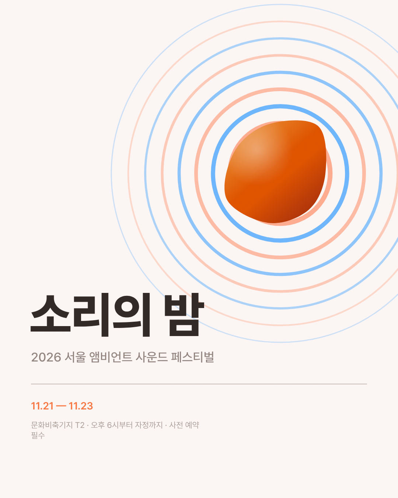
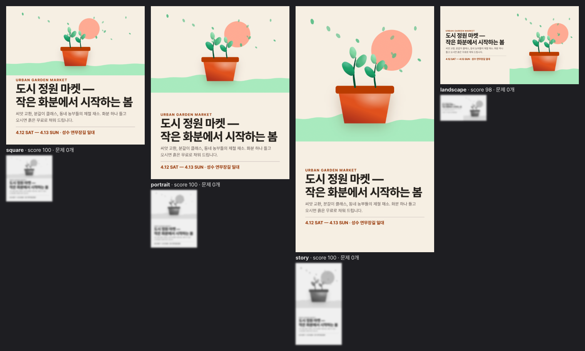
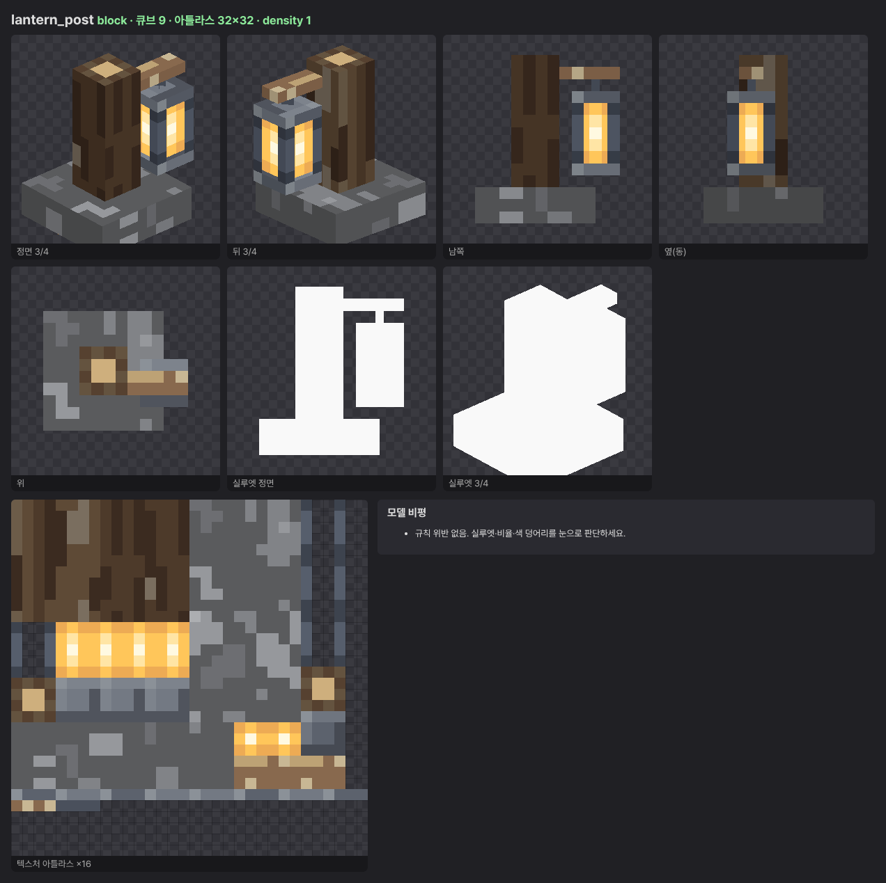
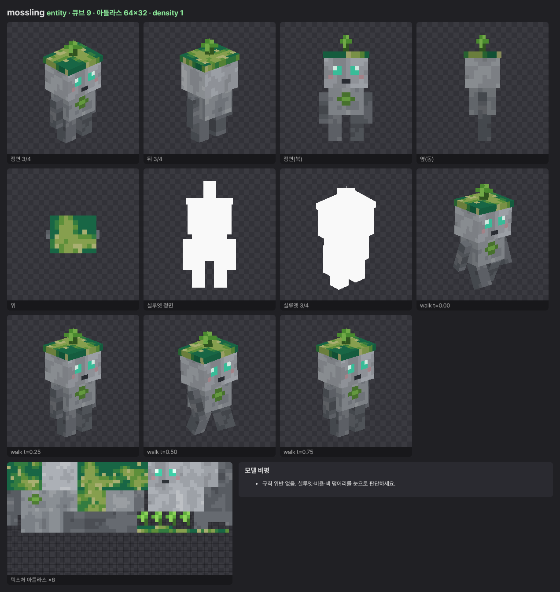

# Atelier

외부 이미지 생성 서비스 없이 **Claude가 혼자 디자인**하게 만드는 로컬 엔진입니다.
그래픽(포스터, 아이콘, 일러스트, SNS 카드)과 **마인크래프트 텍스처·큐브 모델(.bbmodel)**을 만듭니다.

- **손:** 고수준 그리기 DSL(곡선, 붓 획, 유기적 형태, 입체 음영, 질감, 빛, 절차적 배치), 픽셀아트 엔진, 큐브 모델 DSL
- **눈:** 로컬 Chromium·three.js 렌더 → 비평 시트(흑백, 스퀸트, 축소, 확대, 실루엣, 애니메이션 프레임, 타일링) → Claude가 직접 보고 수정
- **감각:** OKLCH 색 토큰, 실측 타이포 레이아웃, 자동 비평기, 스킬 문서 2종
  (`.claude/skills/atelier`, `.claude/skills/minecraft-modeling`)

| 그래픽 | 반응형(1개 함수 → 4개 규격) |
|---|---|
|  →   →  |  |

| 마인크래프트 블록 모델 | 엔티티 모델 + 걷기 애니메이션 |
|---|---|
|  |  |

## 사용법

폰트 설치(1회):
```bash
bash scripts/setup.sh
```
```bash
npm install
```

그래픽:
```bash
node atelier/cli.js render examples/poster-v2.mjs --out out
```
```bash
node atelier/cli.js render examples/market.mjs --formats square,portrait,story,landscape --out out
```
```bash
node atelier/cli.js compare examples/icon-v1.json examples/icon-v2.json --out out
```

마인크래프트:
```bash
node atelier/cli.js sprite examples/mc/blocks.mjs examples/mc/items.mjs --out out/mc
```
```bash
node atelier/cli.js mc examples/mc/lantern_post.mjs examples/mc/mossling.mjs --out out/mc
```
```bash
node atelier/cli.js pack examples/mc/lantern_post.mjs examples/mc/blocks.mjs examples/mc/items.mjs --out out/pack
```

생성 파일
- 그래픽: `png`, `svg`, `sheet.png`(비평 시트), `report.json`
- 마인크래프트: `.bbmodel`(Blockbench 5.0), Java 블록 모델 JSON, 텍스처 PNG, 3D 미리보기 시트, 리소스팩 폴더와 zip

기획과 로드맵은 [docs/PLAN.md](docs/PLAN.md)에 있습니다.
